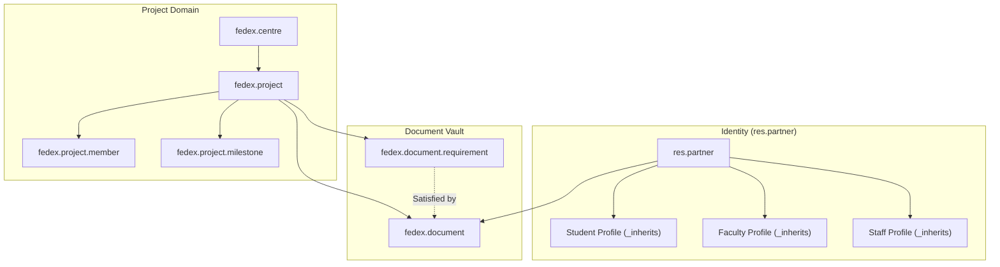

# FedEx Data Repository — Odoo 18

[](https://www.odoo.com/)
[](https://www.gnu.org/licenses/lgpl-3.0)
[](https://www.python.org/)
[](https://github.com/psf/black)

Production-grade **Odoo 18 Community** module implementing an enterprise data repository for research projects, academic personnel, multi-scope document lifecycle management, and analytics.

---

## Table of Contents

- [Overview](#overview)
- [Key Features](#key-features)
- [Module Architecture](#module-architecture)
- [Directory Structure](#directory-structure)
- [Security & Roles](#security--roles)
- [Installation & Requirements](#installation--requirements)
- [Master Data](#master-data)
- [Document System](#document-system)
- [Two-Phase Importer](#two-phase-importer)
- [Dashboard & Search](#dashboard--search)
- [Testing](#testing)
- [Contributing](#contributing)
- [License](#license)

---

## Overview

**FedEx Data Repository** (`fedex_repository`) is an integrated Odoo 18 addon tailored for multi-centre academic and industrial research collaborations (specifically IIT Bombay FedEx ALFA and IIT Madras FedEx SMART). It replaces fragmented spreadsheets with a centralized, auditable relational platform.

---

## Key Features

- **Unified Identity Management:** Extends `res.partner` via delegation inheritance (`_inherits`) to model Student, Faculty, and Staff profiles without duplicating contacts.
- **Relational Project & Member Lifecycle:** Manages research projects, stages (Draft, In Progress, Completed, Cancelled), multi-role member rosters, deliverables, and milestones.
- **Multi-Scope Document Management:** Complete document tracking across three scopes:
  - **Person:** Academic CVs, offer letters, NDAs, identity proofs.
  - **Project:** Charters, progress reports, deliverables, final presentation decks.
  - **Engagement:** Member-specific agreements, joining reports, completion certificates.
- **Document Requirements & Auto-Checklists:** Dynamic checklist generator ensuring mandatory deliverables are satisfied before project completion.
- **Audit Alerts & Monitoring:** Automated cron job auditing nearing-completion projects, overdue milestones, missing prerequisite documents, and expiring contracts.
- **Two-Phase Excel/CSV Importer:** Production-ready wizard with downloadable sample XLSX templates, dry-run validation preview, duplicate policies (`skip` / `update`), and downloadable CSV error reports.
- **Liquid-Glass Modern Dashboard:** Interactive OWL dashboard with live KPI counters, progress metrics, and responsive global search.

---

## Module Architecture



---

## Directory Structure

This repository follows international Odoo Community Association (OCA) standards:

```
fedex_repository/
├── .editorconfig                # Standard cross-editor formatting rules
├── .github/                     # GitHub workflows and issue/PR templates
│   ├── ISSUE_TEMPLATE/
│   │   ├── bug_report.md
│   │   └── feature_request.md
│   ├── pull_request_template.md
│   └── workflows/
│       └── ci.yml               # Automated syntax & XML validation CI
├── .gitignore                   # Comprehensive Python & Odoo ignore rules
├── .pre-commit-config.yaml      # Code quality hooks (black, flake8, isort)
├── CONTRIBUTING.md              # Contribution and PR guidelines
├── LICENSE                      # GNU Lesser General Public License v3.0
├── README.md                    # Main project documentation
├── SINGLE_MODULE_INSTALL.md     # Standalone single-module setup guide
├── __init__.py                  # Root package initializer
├── __manifest__.py              # Odoo module manifest
├── controllers/                 # HTTP controllers (template downloads)
│   ├── __init__.py
│   └── import_controller.py
├── data/                        # System data, cron jobs, sequences
│   ├── cron.xml
│   ├── ir_sequence.xml
│   ├── master_data.xml
│   ├── parameters.xml
│   └── research_taxonomy.xml
├── demo/                        # Demo seed records for testing
│   └── demo.xml
├── docs/                        # Deep-dive documentation
│   ├── architecture.md
│   ├── import_engine.md
│   └── security_matrix.md
├── i18n/                        # Internationalization templates
│   └── fedex_repository.pot
├── models/                      # Relational business models
│   ├── __init__.py
│   ├── alert.py
│   ├── base.py
│   ├── document.py
│   ├── master.py
│   ├── people.py
│   ├── project.py
│   ├── research_extension.py
│   └── settings.py
├── report/                      # Report models and definitions
│   └── __init__.py
├── security/                    # Security groups, rules, and model ACLs
│   ├── fedex_groups.xml
│   ├── fedex_rules.xml
│   └── ir.model.access.csv
├── static/                      # Static web assets and presentation
│   ├── description/
│   │   ├── icon.png             # Odoo app icon (FedEx purple/orange)
│   │   └── index.html           # Odoo App store description page
│   └── src/
│       ├── js/                  # OWL components & dashboard widgets
│       │   ├── dashboard.js
│       │   └── global_search.js
│       ├── scss/                # Liquid-glass stylesheet & theme
│       │   ├── fedex_repository.scss
│       │   └── liquid_glass.scss
│       └── xml/                 # QWeb client action templates
│           └── fedex_repository.xml
├── tests/                       # Automated unit and integration test suite
│   ├── __init__.py
│   ├── test_alerts.py
│   ├── test_automation_contract.py
│   ├── test_constraints.py
│   ├── test_dashboard_search.py
│   ├── test_documents.py
│   ├── test_import.py
│   ├── test_requirements.py
│   ├── test_security.py
│   └── test_views_and_contract.py
├── views/                       # Backend XML views and actions
│   ├── document_views.xml
│   ├── master_views.xml
│   ├── menu_views.xml
│   ├── people_views.xml
│   ├── project_views.xml
│   ├── report_views.xml
│   ├── research_analytics_views.xml
│   ├── research_menu_views.xml
│   ├── research_project_views.xml
│   ├── security_views.xml
│   └── settings_views.xml
└── wizard/                      # Interactive transient wizards
    ├── __init__.py
    ├── import_wizard.py
    ├── import_wizard_views.xml
    ├── member_wizard.py
    ├── member_wizard_views.xml
    ├── replace_wizard.py
    └── replace_wizard_views.xml
```

---

## Security & Roles

The module provides 6 independent security groups:

| Group | Access Scope |
|---|---|
| **Administrator** | Full configuration, security settings, all centres, all records. |
| **Repository Manager** | Full read/write over all centres, projects, members, and import engine. |
| **Coordinator** | Read/write restricted exclusively to projects belonging to their assigned Centre(s). |
| **Faculty** | Read/write restricted to projects where they are Supervisor or assigned Member. |
| **Student** | Read-only access to their assigned projects/engagements; can upload their own documents. Academic data (CGPA, roll no) is locked from student edits. |
| **Management** | Read-only global access across all centres, projects, documents, and analytics. |

---

## Installation & Requirements

### Prerequisites
- **Odoo:** Version 18.0 Community or Enterprise
- **Python:** 3.10, 3.11, or 3.12
- **Database:** PostgreSQL 14+
- **Python Dependencies:** `openpyxl` (required for Excel template generation and parsing)

```bash
pip install openpyxl
```

### Quick Installation

1. Clone or copy `fedex_repository` into your custom addons directory:
   ```bash
   git clone https://github.com/<your-org>/fedex_repository.git /opt/odoo/custom_addons/fedex_repository
   ```

2. Add the custom addons directory to your Odoo configuration file (`odoo.conf`):
   ```ini
   addons_path = /opt/odoo/odoo18/addons,/opt/odoo/custom_addons
   ```

3. Restart Odoo and update the Apps list, or install directly from the command line:
   ```bash
   odoo-bin -c /path/to/odoo.conf -d your_database -i fedex_repository --stop-after-init
   ```

4. For module upgrades:
   ```bash
   odoo-bin -c /path/to/odoo.conf -d your_database -u fedex_repository --stop-after-init
   ```

---

## Master Data

The module pre-configures:
- **Centres:**
  - `IIT Bombay FedEx ALFA`
  - `IIT Madras FedEx SMART`
- **Project Types:** Summer Internship, Full Time Projects, FedEx Scholarship Projects.
- **Taxonomy Categories:** Machine Learning, Supply Chain, Autonomous Systems, Operations Research, etc.
- **Document Types:** Resume / CV, Identity Proof, Joining Letter, Project Charter, Interim Report, Final Presentation, Completion Certificate.

---

## Document System

- **Scoping Rules:**
  - `Person`: Bound to a contact (`res.partner`).
  - `Project`: Bound to a research project (`fedex.project`).
  - `Engagement`: Bound to a project roster member (`fedex.project.member`).
- **File Constraints:** Allowed file extensions and maximum upload sizes (default 25 MB) are centrally configured in **Configuration → Settings**.
- **Versioning:** Replacing a document preserves previous revisions in the archive, creates an audit log on chatter, and automatically rebinds pending requirement checklists.

---

## Two-Phase Importer

Batch import data securely in **FedEx Repository → Import**:
1. Select Target Entity: Students, Faculty, Staff, Projects, or Project Members.
2. Click **Download Template** to receive a pre-formatted `.xlsx` template.
3. Upload CSV or XLSX and click **Validate & Preview**.
4. Review preview lines with badges (`New`, `Update`, `Duplicate`, `Error`).
5. If errors occur, download the detailed error report CSV.
6. Choose Duplicate Policy (`Skip` or `Update`) and click **Confirm Import**.

---

## Dashboard & Search

Access the real-time analytics dashboard under **FedEx Repository → Dashboard**:
- **KPI Metrics:** Total Active Projects, Projects Nearing Completion, Missing Documents, and Total Researchers.
- **Real-Time Global Search:** Live search across project codes, titles, students, supervisors, and document titles.
- **Visual Analytics:** Native pivot and graph reports grouped by centre, vertical, stage, and sponsor.

---

## Testing

Run the automated test suite with `odoo-bin`:

```bash
odoo-bin -c /path/to/odoo.conf -d test_db -i fedex_repository --test-enable --stop-after-init
```

The test suite covers:
- Document versioning, checklists, and scope constraints (`test_documents.py`).
- Security group ACLs and centre-scoping record rules (`test_security.py`).
- Import validation, dry-runs, and duplicate policies (`test_import.py`).
- Alert generation cron contracts (`test_alerts.py`, `test_automation_contract.py`).
- Field validations and unique constraints (`test_constraints.py`).

---

## Contributing

Contributions are welcome! Please read [CONTRIBUTING.md](CONTRIBUTING.md) for details on code style, pre-commit configuration, and pull request procedures.

---

## License

This project is licensed under the **GNU Lesser General Public License v3.0 (LGPL-3)** — see the [LICENSE](LICENSE) file for details.
