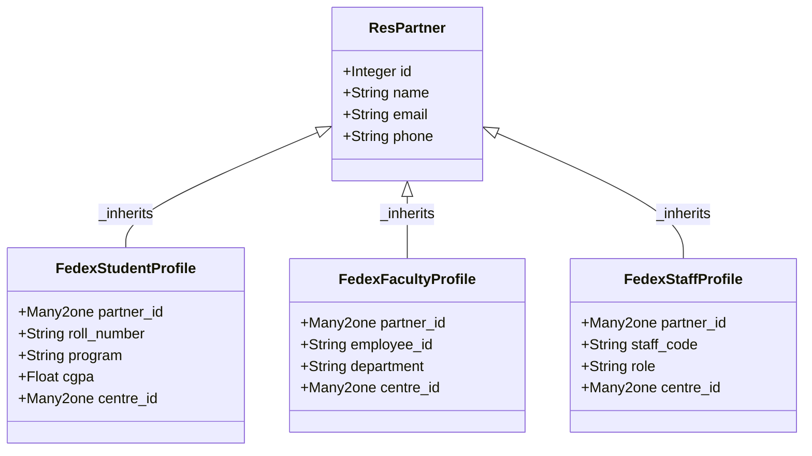
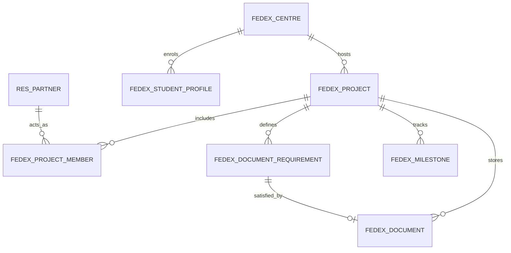

# Architecture & Data Models

The **FedEx Data Repository** module is designed with a high-integrity relational model following Odoo enterprise patterns.

## Identity & Delegation Inheritance

Personal identities in FedEx Data Repository leverage Odoo's standard `res.partner` table via delegation inheritance (`_inherits`). This guarantees seamless interoperability with native contact books, messaging chatter, and mail tracking.

## Relational Model Architecture

## Core Models Reference

| Technical Name | Human Label | Purpose |
|---|---|---|
| `fedex.centre` | Centre | IIT Bombay FedEx ALFA & IIT Madras FedEx SMART centres |
| `fedex.project` | Project | Research project lifecycle (Draft, Approved, In Progress, Completed, Cancelled) |
| `fedex.project.member` | Project Member | Team members, interns, co-supervisors, with duration and certificate flags |
| `fedex.project.milestone` | Milestone | Project deliverable milestones with due dates and completion states |
| `fedex.document` | Document | Document repository items (Person, Project, or Engagement scope) |
| `fedex.document.requirement` | Requirement | Checklist requirements bound to projects/members |
| `fedex.alert.log` | Alert Log | Automated audit alerts triggered by scheduled cron jobs |
