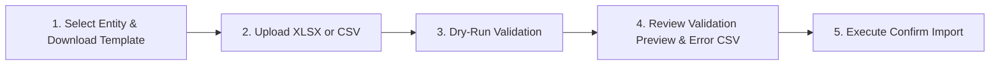

# Two-Phase Excel / CSV Import Engine

The import system provides a safe, idempotent mechanism for batch onboarding data into FedEx Data Repository.

## Supported Entities
- Students (`students`)
- Faculty (`faculty`)
- Staff (`staff`)
- Projects (`projects`)
- Project Members (`project_members`)

## Workflow

## Validation & Duplicate Policies
- **Dry-run Execution**: The validation phase computes row status (`new`, `update`, `duplicate`, `error`) without persisting business objects to PostgreSQL.
- **Duplicate Policy**:
  - `skip`: Existing matching records are left untouched.
  - `update`: Existing matching records are updated in-place with non-empty imported values.
- **Lookup Resolution**: Case-insensitive lookup against master tables (Centres, Roles, Categories, Sponsors). If `create_missing_lookups` is toggled off, unrecognised foreign keys generate row validation errors.
- **Error Export**: When validation finds rows with errors, an exportable error CSV report is automatically generated and downloadable directly from the wizard form.
