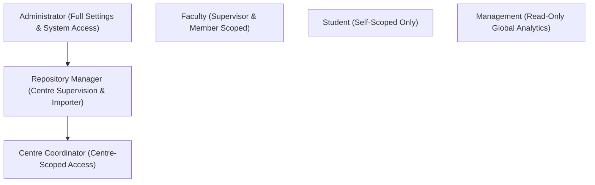

# Security Matrix & Access Controls

The security model implements role-based access control (RBAC) and record-level rule segregation complying with institutional privacy requirements (including India DPDP Act considerations for restricted student data).

## Security Groups Hierarchy

## Matrix Permissions Table

| Group | Projects | Members / Milestones | Documents | Person Profiles | Import Wizard | Settings |
|---|---|---|---|---|---|---|
| **Administrator** | Full CRUD | Full CRUD | Full CRUD | Full CRUD | Yes | Yes |
| **Repository Manager** | Full CRUD | Full CRUD | Full CRUD | Full CRUD | Yes | No |
| **Coordinator** | Centre-Scoped CRUD | Centre-Scoped CRUD | Centre-Scoped CRUD | Centre-Scoped CRUD | No | No |
| **Faculty** | Supervised / Member Projects (R/W) | Member Scoped | Project / Self Uploads | Read-Only | No | No |
| **Student** | Assigned Projects (Read-only) | Self Engagement (Read-only) | Self Uploads / Replace | Own Profile (Self Documents) | No | No |
| **Management** | Read-Only (All) | Read-Only (All) | Read-Only (All) | Read-Only (All) | No | No |

## Record Rules Highlights
- **Coordinators**: Dynamic domain filter checking allowed centres assigned via `user.centre_ids`.
- **Faculty**: Multi-supervisor logic allowing view and edit access if assigned as `supervisor_id` or member with Supervisor/Co-supervisor role.
- **Students**: Explicitly prohibited from modifying academic fields (such as CGPA, student status, or enrollment data) via ACL and form field restrictions.
